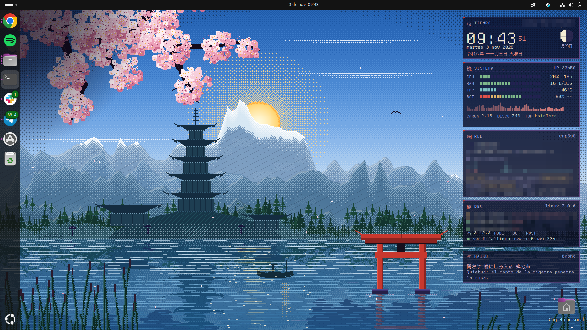

# PixelZen

> Tema de escritorio para **KDE Plasma 6** en pixel art: paisaje japonés animado que sigue al sol de tu ciudad, panel de datos, iconos y cursor a juego.
> Artículo con capturas y cómo está hecho: **https://ralcaniz.dev/posts/pixelzen-escritorio-kde-pixel-art/**


**Instalación rápida:** descarga `pixelzen-1.0.tar.gz` desde [Releases](../../releases), descomprímelo y haz doble clic en **«Instalar PixelZen»** (o ejecuta `./instalar.sh`).

SHA-256 del paquete 1.0: `d11705d136cf5e91ca4bc23061971ad66b7fe0ab895d3a112123022c729d89ba`

Licencia: GPL-3.0-or-later (código y arte). Las fuentes y los glifos de iconos mantienen sus propias licencias, en `licencias/`.

Un tema de escritorio completo para **KDE Plasma 6** con estética de **Japón antiguo en pixel art**:
paisaje animado que sigue el sol de tu ciudad, ventanas, iconos y cursor pixel, una barra mínima y un
HUD con datos del sistema, de la red y de desarrollo. Todo se genera con **Python puro** (sin dependencias).

## Capturas


**El escritorio.** Un paisaje japonés dibujado píxel a píxel (pagoda, torii, lago, montaña nevada y cerezo en flor), una barra superior mínima y, en la columna libre de la derecha, el panel de datos (HUD).

### El fondo sigue al sol

| Amanecer | Noche |
|---|---|
|  |  |

El fondo no es una imagen fija: es una escena animada que cambia con la **hora real de tu ciudad**.

- El sol sale por el este, cruza el cielo y se pone por el oeste según la fecha y tu latitud. El cálculo se hace en local, así que **no usa red**.
- El paisaje existe en tres iluminaciones (noche, hora dorada y día) que se mezclan según la altura del sol.
- De noche aparecen la luna, las estrellas, las luces de la pagoda y las luciérnagas.
- La ubicación sale de tu zona horaria, o de una ciudad que fijes con `./instalar.sh --casa=LAT,LON,"Ciudad"`.
- Para verlo anochecer sin esperar: `~/.local/share/pixelzen/src/hora.sh demo` (24 horas en 90 segundos). Con `hora.sh real` vuelve a la hora del reloj.

### En movimiento

Cuatro momentos del día, grabados de verdad (unos 10 segundos cada uno). Se mueven las nubes, los pétalos, los farolillos, las luciérnagas, las grullas y los destellos del lago.

| Noche | Amanecer |
|---|---|
|  |  |
| **Hora dorada** | **Día** |
|  |  |

*En cada animación el fondo tiene fijada una hora (con `hora.sh`), mientras que el reloj del panel marca la hora real. Los datos del panel son ficticios (modo demo).*

### El panel de datos (HUD)

El panel de la derecha es un widget de Plasma con un motor de datos en Python que **solo lee** (`/proc`, `sysfs`, `ss`, `ip`, `git`): sin red y sin `sudo`. Tiene seis tarjetas:

- **Tiempo:** reloj, calendario japonés y fase lunar.
- **Sistema:** CPU, RAM, temperatura y batería.
- **Red:** conexión, IP, VPN, velocidad y puertos en escucha (los expuestos a toda la red, en ámbar).
- **Dev:** estado de tus repositorios git, versiones de Python, Node, Go y Rust, y servicios fallidos.
- **Herramientas:** botones que abren una terminal con `btop`, `ss`, `dig`, `ping`... según lo que tengas instalado.
- **Haiku:** un verso clásico que rota con fundido.

Se escala con la altura de la pantalla, así que ocupa lo mismo en un portátil que en un monitor grande.

### Pantalla de bloqueo


La pantalla de bloqueo usa el mismo fondo animado.

### Iconos y cursor


Unos 3000 nombres de icono de KDE traducidos a glifos de [Pixelarticons](https://github.com/halfmage/pixelarticons) (licencia MIT), con azulejos de aplicaciones, carpetas y hojas de archivo dibujados para este tema. Lo que no cubre cae a Breeze, así que nada se rompe. El cursor es una flecha con la punta roja de un torii, escrito a mano en formato Xcursor.

### Terminal


Paleta propia para Alacritty y Konsole, con un prompt de fish a juego. La fuente de datos y terminal es Departure Mono, elegida entre ocho por ser la más legible (distingue `0` de `O`, `I` de `l` de `1`).

*Las capturas usan el modo demo, que sustituye tu red, IP y VPN por datos ficticios (`touch ~/.config/pixelzen/demo`).*

## Qué incluye

| Pieza | Qué es |
|---|---|
| Fondo animado | Plugin de Plasma. Sol y luna recorren el cielo según tu hora y ubicación; el paisaje pasa de noche a hora dorada y a día. Estrellas, nubes, farolillos, pétalos, luciérnagas, grullas y estrellas fugaces. También en la pantalla de bloqueo. |
| HUD | Widget con reloj (calendario japonés y fase lunar), sistema, red y puertos, desarrollo, herramientas y haiku. Solo lectura, sin red, sin `sudo`. |
| Ventanas | Decoración Aurorae con marco pixel y botones cuadrados. |
| Panel | Barra superior mínima: inicio, apps, reloj, bandeja reducida. |
| Iconos | ~3000 iconos pixel (glifos Pixelarticons + azulejos, carpetas y hojas propias). Lo no cubierto cae a Breeze. |
| Cursor | Cursor Xcursor pixel con punta roja de torii. |
| Terminal | Alacritty y Konsole, prompt de fish a juego. |
| Tipografía | Departure Mono (datos y terminal), Pixelify Sans (interfaz), DotGothic16 (kanji). |

## Requisitos

KDE Plasma 6 (Wayland o X11), `python3`, `qdbus6`, `kwriteconfig6`, `fc-cache`. Alacritty y fish son opcionales.

## Instalar

**Lo más fácil (2 clics):** descomprime el paquete, haz **doble clic en «Instalar PixelZen»** y pulsa *Instalar*.
Se encarga de todo y avisa cuando termina.

**Desde la terminal:**

```bash
tar xzf pixelzen-1.0.tar.gz && cd pixelzen-1.0
./instalar.sh                                   # usa tu zona horaria para el sol
./instalar.sh --casa=39.5,-0.4,"Mi ciudad"      # o fija tu ubicación
```

**Si no usas KDE Plasma 6:** el tema completo no funciona (el fondo animado y el HUD son componentes de Plasma),
pero puedes instalar solo las piezas estándar: `./instalar.sh --portable` (iconos, cursor y fuentes; experimental,
sin probar fuera de Plasma). Después elige `PixelZen` y `PixelZenCursor` en los ajustes de tu escritorio.

**Si usas GNOME:** hay una versión con el fondo animado que sigue al sol y el panel de datos, hecha como
extensión de GNOME Shell: `cd gnome && ./instalar.sh`. La mantiene
[@arnau-romero-hazas](https://github.com/arnau-romero-hazas) y solo está probada en Ubuntu 24.04 con GNOME 46
sobre X11. Detalles en [gnome/LEEME.md](gnome/LEEME.md).



Solo toca tu usuario, nunca usa `sudo`. Antes de cambiar nada guarda una copia de tus ajustes en
`~/.local/share/pixelzen/backup/original/`.

## Uso

```bash
~/.local/share/pixelzen/src/hora.sh 21:30   # congela la hora del fondo
~/.local/share/pixelzen/src/hora.sh demo    # 24 h en 90 s para ver anochecer
~/.local/share/pixelzen/src/hora.sh real    # vuelve a la hora del reloj

~/.local/share/pixelzen/aplicar.sh iconos   # reaplica una sola parte
# pasos: todo colores plasma ventanas fuentes terminal iconos cursor animado hud panel bloqueo
```

La ubicación se calcula **sin red**: tu zona horaria (`zone1970.tab`) o la `casa` de
`~/.config/pixelzen/ubicacion.json`. Con `~/.config/pixelzen/demo` el HUD muestra datos ficticios (útil para capturas).

## Deshacer

```bash
~/.local/share/pixelzen/revertir.sh         # vuelve a tu configuración anterior
~/.local/share/pixelzen/desinstalar.sh      # además borra los temas (--todo borra también el proyecto)
```

## Cómo está hecho

- `src/fondo3.py` dibuja el paisaje (640×400, ampliado ×3) con paletas por fase; `src/capas.py` separa cielo y
  escena con un recorte por diferencia de fondo (sobre negro y sobre blanco) y crea los sprites del sol y la luna.
- El plugin QML (`fondo-animado/`) mezcla las tres iluminaciones según la altura del sol, calculada con la
  posición solar de la NOAA, y anima las capas a 8 fps.
- `src/iconos.py` traduce ~3000 nombres de icono de KDE a glifos pixel; `src/cursor.py` escribe el formato Xcursor a mano.
- `src/construir.py` genera el esquema de colores, el tema de Plasma (marcos pixel en SVG), las ventanas y las terminales.
- `hud/` contiene los plasmoides QML y `datos.py`, el motor de datos.

## Licencias

Código y arte generado: GPL-3.0-or-later (`licencias/GPL-3.0.txt`). Fuentes: SIL OFL 1.1 (Departure Mono,
Pixelify Sans, DotGothic16, VT323). Glifos: Pixelarticons, MIT (© Gerrit Halfmann). Textos en `licencias/`.
