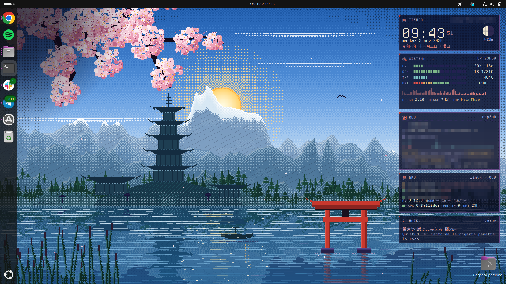
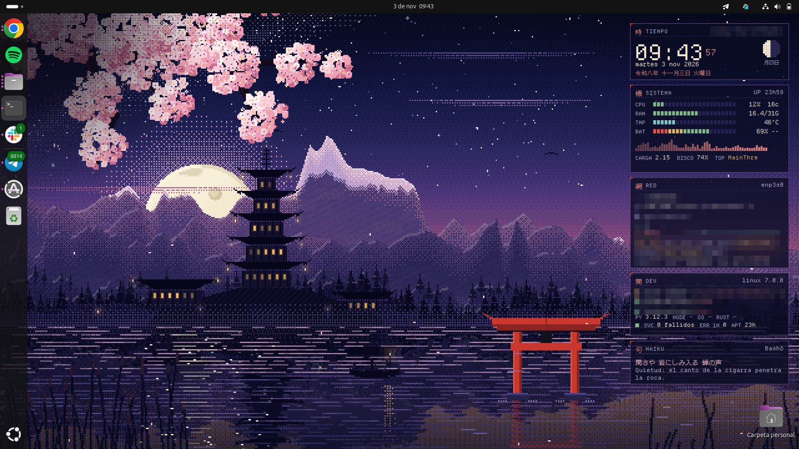

# PixelZen para GNOME

Versión de PixelZen para **GNOME Shell** que incluye las dos piezas que más se echan de menos fuera de Plasma:

- **Fondo animado que sigue al sol.** Es el mismo paisaje y la misma lógica que el plugin de Plasma: el sol
  y la luna recorren el cielo según tu hora y tu ubicación, el paisaje pasa de noche a hora dorada y a día,
  y se mueven las nubes, los pétalos, los farolillos, las luciérnagas, las grullas, las estrellas fugaces y
  los destellos del lago.
- **Panel de datos (HUD)** en la columna derecha, con las tarjetas Tiempo (reloj, calendario japonés y fase
  lunar), Sistema (CPU, RAM, temperatura, batería, carga y disco), Red (wifi, IP, VPN, velocidad y puertos),
  Dev (repos git, versiones y servicios fallidos) y Haiku. Solo lee datos, sin red y sin `sudo`.

Es una extensión de GNOME Shell, así que dibuja en el fondo real del escritorio: queda por debajo de las
ventanas y de los iconos del escritorio de Ubuntu, en todos los monitores.

| Día | Anochecer | Noche (monitor secundario, sin panel) |
|---|---|---|
|  |  |  |

Capturas en Ubuntu 24.04 con GNOME 46 sobre X11. Los datos personales del panel están pixelados.

> **Mantenimiento y estado.** Este port lo mantiene [@arnau-romero-hazas](https://github.com/arnau-romero-hazas),
> no el autor de PixelZen, que usa KDE Plasma y no puede probarlo. Los fallos de la versión GNOME conviene
> abrirlos como issue mencionando a @arnau-romero-hazas.
>
> **Solo está probado en Ubuntu 24.04 con GNOME 46 sobre X11.** Wayland y GNOME 47 o 48 deberían funcionar
> (`metadata.json` los declara y el código contempla sus diferencias de API), pero nadie lo ha verificado.

## Instalar

```bash
cd gnome
./instalar.sh                                # ubicación a partir de tu zona horaria
./instalar.sh --casa=39.5,-0.4,"Mi ciudad"   # o fija tu ubicación
```

Después hay que reiniciar GNOME Shell. En **X11** basta con pulsar `Alt+F2`, escribir `r` y pulsar Intro
(no se cierra ninguna ventana). En **Wayland** hay que cerrar sesión y volver a entrar.

El instalador:

- Copia la extensión a `~/.local/share/gnome-shell/extensions/pixelzen@mosqui1988.github.io`.
- Dibuja las capas del paisaje con `src/capas.py` y `src/fondo3.py`, los mismos scripts de la versión de
  Plasma (Python puro).
- Instala las fuentes pixel en `~/.local/share/fonts/pixelzen`.
- Pone una imagen fija del paisaje como fondo de GNOME, que es la que se ve en Actividades y en la pantalla
  de bloqueo. Antes guarda tu fondo anterior. Usa `--sin-fondo` si no quieres cambiarlo.

Solo toca tu usuario y nunca usa `sudo`.

## Uso

```bash
./hora.sh 21:30   # congela la hora del fondo
./hora.sh demo    # 24 horas en 90 segundos, para verlo anochecer
./hora.sh real    # vuelve a la hora del reloj
```

Más ajustes con `gsettings` (el esquema está dentro de la extensión):

```bash
S=~/.local/share/gnome-shell/extensions/pixelzen@mosqui1988.github.io/schemas
gsettings --schemadir $S set org.gnome.shell.extensions.pixelzen fps 6               # 2..24 (8 por defecto)
gsettings --schemadir $S set org.gnome.shell.extensions.pixelzen animar false        # fondo quieto
gsettings --schemadir $S set org.gnome.shell.extensions.pixelzen todos-monitores false
gsettings --schemadir $S set org.gnome.shell.extensions.pixelzen hud false           # sin panel
gsettings --schemadir $S set org.gnome.shell.extensions.pixelzen hud-monitor 1       # panel en otro monitor
```

## Consumo

- **Animación:** a 8 cuadros por segundo, con las texturas compartidas entre monitores. Se pausa sola con
  la pantalla bloqueada o cuando hay una ventana a pantalla completa en el monitor principal.
- **Panel:** lanza `datos.py` cada 2 segundos (CPU, RAM, red) y cada 20 segundos (puertos, repos), igual
  que el widget de Plasma.

Si quieres gastar menos, baja `fps` o pon `todos-monitores` a `false`.

CPU que añade a GNOME Shell, medida en un portátil con Intel Alder Lake y 3 monitores (1080p, 1080p y
1080×1920 en vertical), en X11. Son porcentajes de un núcleo y la RAM añadida es de unos 2 MB:

| Ajuste | CPU añadida |
|---|---|
| `animar false` | ~0 % |
| 4 fps, 3 monitores | ~3 % |
| 8 fps, solo el principal | ~5 % |
| 8 fps, 3 monitores | ~9–10 % |
| 12 fps, 3 monitores | ~18 % |

Como en el plugin de Plasma, el movimiento avanza un paso por cuadro. Por eso, con más `fps` la
animación es más fluida pero también más rápida.

Los píxeles animados se dibujan con Cairo en un lienzo de 640×400, y los monitores secundarios usan
un `Clutter.Clone` de ese lienzo. Así la escena se calcula una sola vez por cuadro, sea cual sea el
número de monitores.

## Diferencias con la versión de Plasma

- La tarjeta **Herramientas** no está, porque en GNOME los clics sobre el escritorio los recibe la capa de
  iconos de Ubuntu.
- La línea **APT** muestra cuánto hace que se actualizó la lista de paquetes (en Arch es pacman).
- La pantalla de bloqueo muestra la imagen fija, no la animación.
- Las ventanas, los iconos, el cursor y la barra no forman parte de este port. Los iconos y el cursor se
  pueden instalar con `./instalar.sh --portable` desde la raíz del repositorio.

## Desinstalar

```bash
./desinstalar.sh   # quita la extensión y las fuentes y devuelve tu fondo anterior
```
